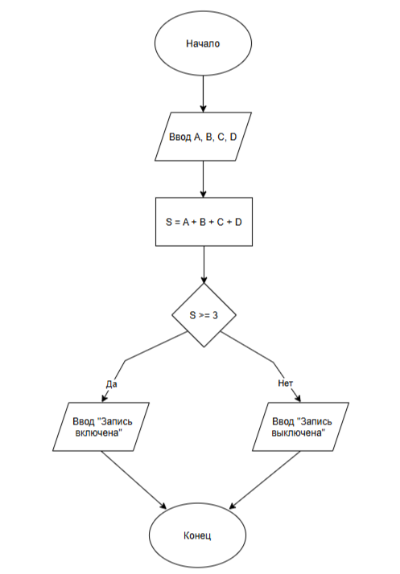

# Домашнее задание к работе 2

## Условие задачи
В зале музея четыре датчика движения (A, B, C, D). Чтобы избежать ложных срабатываний, сигнализация включает запись только если не менее трех датчиков сработали (система интерпретирует срабатывания как "повторяющееся движение", а не "шум"). Запишите условие включения записи.

## 1. Алгоритм и блок-схема

### Алгоритм
1. **Начало**
2. Ввести состояние датчиков: A, B, C, D (каждое - 0 или 1)
3. Вычислить сумма сработавших датчиков: S = A + B + C + D
4. Проверить условие: если S >= 3, то запись включить, иначе - не включать
5. Вывести результат: "Запись включена" или "Запись выключена"
6. **Конец**

### Блок-схема
 

 [Вставьте ссылку на изображение вашей блок-схемы, созданной в draw.io^](# "как lab_2_schema.png")

## 2. Реализация программы

#define _CRT_SECURE_NO_WARNINGS
#include <stdio.h>
#include <locale.h>

int main()
{
	setlocale(LC_CTYPE, ".UTF-8");

	int A, B, C, D; //состояние датчиков (0 или 1)
	int W; // результат 1 - запись включена, 0 - запись выключена

	printf("Введите состояние датчиков A B C D 1(запись включена) или 0(запись выключена) через пробел\n");
	scanf("%d %d %d %d", &A, &B, &C, &D);

	W = (A && B && C) || (A && B && D) || (A && C && D) || (B && C && D);

	if (W)
		printf("Запись включена (сработало не менее трех датчиков)\n");
	else
		printf("Запись выключена\n");
	
	return 0;
}

## 3. Результаты работы программы

Введите состояние датчиков A B C D 1(запись включена) или 0(запись выключена) через пробел
1 0 1 1
Запись включена (сработало не менее трех датчиков)

## 4. Информация о разработчике

Черкасова Ульяна Алексеевна бТИИ-261 (1 подгруппа)
